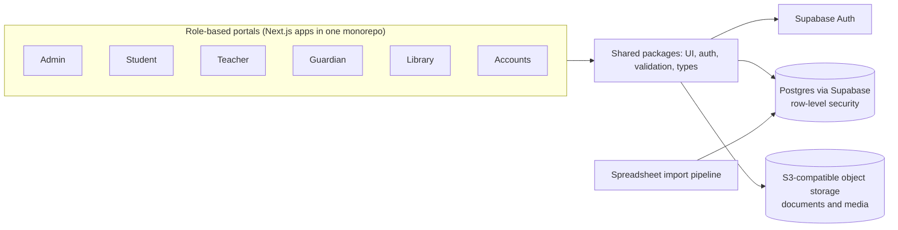
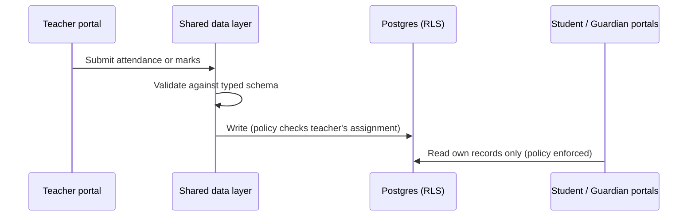

# US-Bangla Medical College: Multi-Portal ERP

> **Architecture case study.** Source code is private and owned by the client. This repository contains original documentation only: no client code, data, credentials or assets.

## Architecture



## Problem

A medical college runs admissions, academics, attendance, examinations, library and fees across several groups of people: administrators, faculty, students, guardians and the accounts office. Spreadsheets and disconnected tools made records hard to keep consistent, and each group needed a different view of the same data.

## Solution

A single ERP with six role-specific portals on one shared data model. Each portal shows only what its role needs, while every portal reads from and writes to the same source of truth. Historical records from spreadsheets are brought in through a validated import pipeline.

## Key flow



## Modules

- **Admin**: institution setup, users and roles, academic structure, oversight
- **Student**: profile, attendance, results, fees, notices
- **Teacher**: classes, attendance capture, assessment entry
- **Guardian**: read-only view of a student's progress and dues
- **Library**: catalogue, issue and return
- **Accounts**: fee structures, invoices, payments, reports

## Tech stack

- TypeScript, Node.js 20
- Next.js applications in a pnpm + Turborepo monorepo
- Supabase (Postgres, Auth)
- S3-compatible object storage
- Zod for validation at boundaries
- Vitest and Playwright for tests

## Key design decisions

1. One monorepo, many portals: separate deployable apps per role, with shared UI, auth and validation packages so rules are written once.
2. Access control is enforced in the database (row-level policies), not only in the UI, so a portal cannot see data its role should not see.
3. Every external input (forms, spreadsheet imports) is validated against a typed schema before it is stored.
4. Files are kept in object storage and referenced from the database rather than stored in it.
5. A deliberate v2 rebuild consolidated earlier iterations into a cleaner, testable structure.

## Illustrative data outline

Generic, simplified outline written for this case study. It is not the production schema.

```text
institution(id, name)
person(id, role[admin|teacher|student|guardian|staff])
programme(id, name) -> batch(id, programme_id, year)
enrolment(student_id, batch_id)
course(id, programme_id) -> session(id, course_id, date)
attendance(session_id, student_id, status)
assessment(id, course_id) -> mark(assessment_id, student_id, score)
fee_item(id, batch_id, amount) -> payment(id, student_id, fee_item_id)
```

---

Designed and delivered by [Adil Ahmed](https://github.com/AdilAhmedAhir) at [Start Daily xyz Limited](https://startdaily.xyz), Dhaka.
